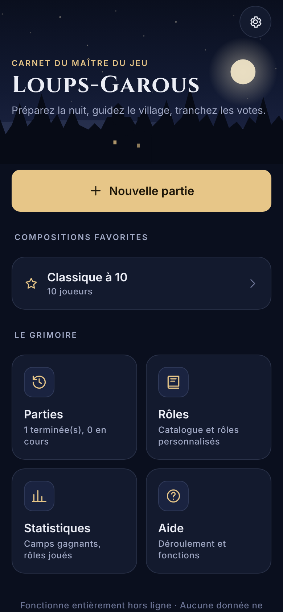
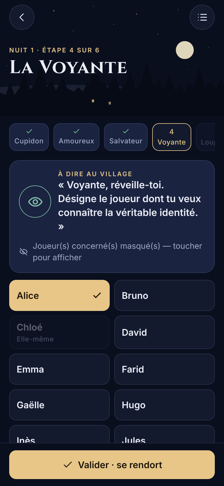
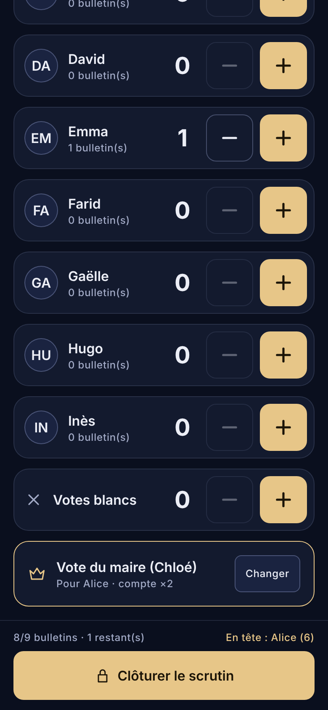
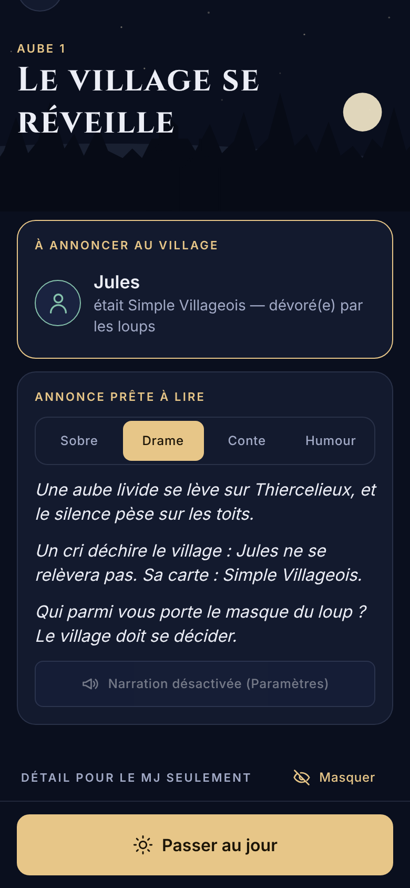
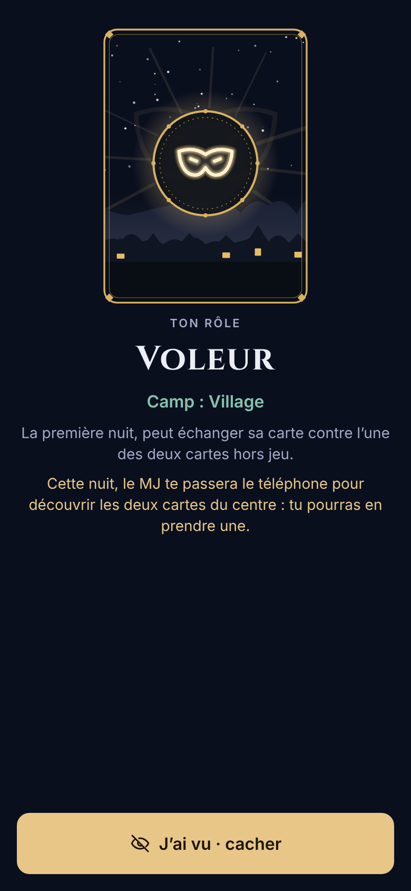
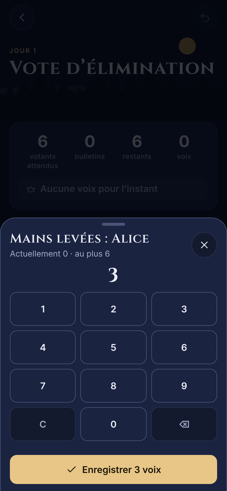
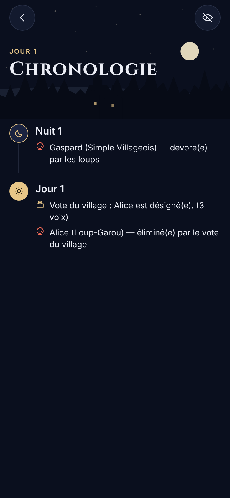
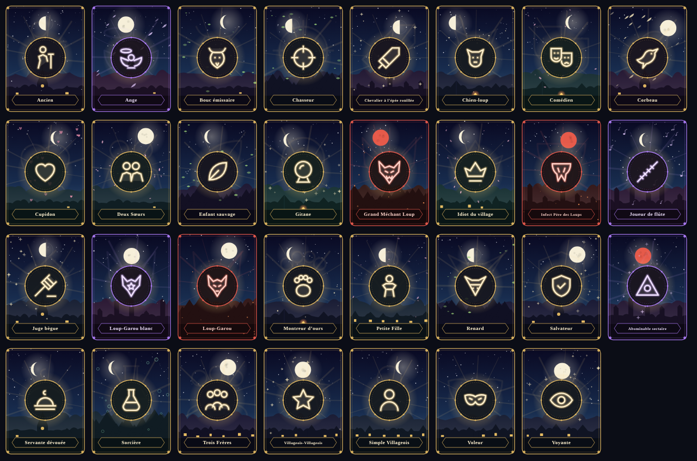

# Loups-Garous MJ

Application iPhone et iPad pour le **maître du jeu** des *Loups-garous de Thiercelieux* (et extensions *Nouvelle Lune*, *Le Village* — Corbeau, Loup blanc — et *Personnages*). Les joueurs gardent leurs cartes physiques ; le MJ prépare la partie, est guidé pas à pas pendant les nuits, tranche les votes, et l’application applique les règles, enregistre tout et permet de corriger chaque erreur.

- **100 % hors ligne** : aucun compte, aucun serveur, aucune publicité, aucun achat intégré, aucune télémétrie.
- Données stockées localement (SQLite), sauvegarde automatique après chaque action, reprise après fermeture.
- Expo SDK 58 · React Native 0.88 · TypeScript strict · Expo Router.

<p>




</p>
<p>




</p>

> Captures **réelles** de l’application, exécutée via son export web dans Chromium (format iPhone 390 × 844). Aucune capture iOS native n’a pu être produite dans l’environnement de développement (Linux, sans simulateur) — voir [docs/TEST_REPORT.md](docs/TEST_REPORT.md).

## Fonctionnalités

| Domaine | Contenu |
| --- | --- |
| Création de partie | joueurs (liste ou **plan de table** avec glisser-déposer, joueurs habituels), cartes à la main ou composition automatique expliquée (option **équilibrée d’après vos parties**), tirage par l’app (**Voleur selon la règle officielle : deux cartes ajoutées au paquet**), **distribution sur le téléphone** ou saisie des cartes reçues, groupes du Sectaire, variantes, compositions favorites |
| Nuit | guide pas à pas dans l’ordre officiel, phrase à prononcer, **rappels contextuels**, joueurs concernés masquables, résultat Voyante/Renard, Gitane, **cartes du centre montrées au Voleur sur un écran privé**, appels « pour la forme », correction d’une étape validée, narration vocale, **hurlement** au réveil des loups |
| Aube | annonce publique, **annonce prête à lire** (sobre, drame, conte, humour), ours du Montreur, Spiritisme, décisions bloquantes |
| Jour | **minuteur de débat** (alerte, vibration, +1 min), **cartes Événement Nouvelle Lune** (tirage, rappels, application automatique ou guidée), **outils du MJ** |
| Votes | élection du maire, vote d’élimination en mode compteur (+/−) ou **nombre de mains levées** au pavé numérique, nominatif, vote du maire ×2, Corbeau, égalités selon variantes, grâce (Pile ou face), réouverture, annulation de la dernière opération |
| Rôles | 31 rôles intégrés vérifiés dans les **livrets officiels**, avec **illustrations originales**, rôles personnalisés déclaratifs avec **conditions de victoire calquées sur les rôles officiels** |
| Suivi | **chronologie visuelle**, **plan de table** (voisins), historique, annulation, retour arrière, correction avec recalcul complet, **rejeu pas à pas** |
| Après la partie | résumé, **image récapitulative partageable** (générée sur l’appareil), statistiques globales et **par joueur** |
| Réglages | 4 thèmes, mode discret, **contraste élevé**, **animations réduites**, Dynamic Type, ambiances **vent, pluie, orage**, cloche, volumes, narration, variantes par défaut, export/import JSON |
| iPad et paysage | **deux colonnes** (guide ou phase à gauche, plateau des joueurs à droite), Split View |

## Prérequis et lancement

- Node.js 22 (testé avec 22.22), npm 10.
- Pour iOS : un Mac avec Xcode, ou EAS Build (`npx eas-cli build -p ios`). Les modules natifs utilisés (expo-sqlite, expo-audio, expo-speech…) nécessitent une *development build* (`npx expo run:ios`), pas Expo Go seul.

```bash
npm install
npx expo run:ios          # build de développement sur simulateur / iPhone (macOS)
npm run web               # version web de développement (http://localhost:8081)
```

## Qualité et tests

```bash
npm run typecheck         # TypeScript strict
npm run lint              # ESLint (config Expo)
npm test                  # Jest : moteur, persistance, audio, état, intégration UI, audit d’accessibilité (204 tests)
npm run test:coverage
FUZZ_SEEDS=2000 npx jest src/engine/__tests__/fuzz.test.ts   # fuzzing prolongé
npm run build:web && npx playwright test                     # E2E (Chromium sur l’export web)
MONKEY_SEED=23 MONKEY_STEPS=1000 npx playwright test e2e/monkey.spec.ts
SCREENSHOTS=1 npx playwright test e2e/screenshots.spec.ts e2e/screenshots-new.spec.ts   # régénère docs/screenshots/web
npx expo-doctor
```

Régénérer les ressources : `npm run generate:audio` (sons de synthèse), `node scripts/generate-icons.mjs` (icônes), `node scripts/render-mockups.mjs` (maquettes), illustrations des rôles : `ROLE_ART_OUT=/tmp/svg npx jest src/art && node scripts/render-role-art.mjs /tmp/svg docs/illustrations`.

## Documentation

- [Architecture et décisions techniques](docs/ARCHITECTURE.md)
- [Règles, rôles, variantes, ajout d’un rôle ou d’une variante](docs/RULES.md)
- [Rapport de tests](docs/TEST_REPORT.md)
- [Bugs corrigés et problèmes ouverts](docs/BUGS.md)
- [Maquettes et comparaison avec l’application](docs/mockups/COMPARAISON.md)
- [Étapes avant publication sur l’App Store](docs/STORE_CHECKLIST.md)

## Structure

```
src/
  app/            routes Expo Router (fichiers fins qui rendent un écran)
  screens/        écrans (accueil, création, jeu, rôles, réglages…)
  components/     composants d’interface réutilisables
  engine/         moteur de règles pur TypeScript (aucune dépendance UI)
  storage/        SQLite : pilote, migrations, dépôt, validation
  state/          stores (zustand), brouillon, sauvegarde automatique, statistiques
  audio/          gestionnaire audio, sons, narration
  art/            illustrations des rôles et image récapitulative (SVG générés)
  theme/          jetons de conception, thèmes, contrastes
  settings/       modèle et validation des paramètres
e2e/              tests Playwright
scripts/          générateurs (sons, icônes, maquettes), serveur web local
docs/             documentation, maquettes, captures
```
